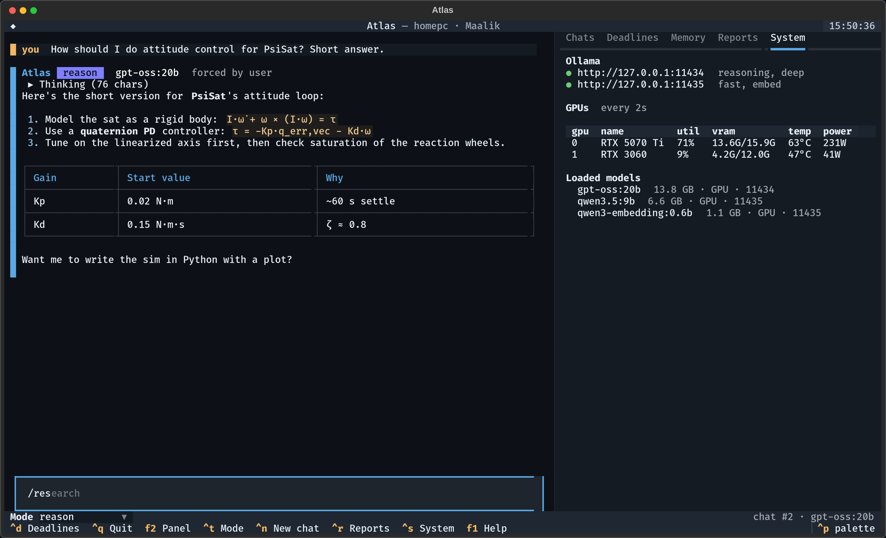

# Atlas: setup and usage (phase 1 + TUI)

Atlas is a local multi-model assistant built on [Ollama](https://ollama.com). It runs on
Muhammad's Fedora 44 machines.

Repo: `~/Desktop/Notes/Notes/atlas`. All data lives in `atlas/data/` (SQLite, reports, workspace).

## New: the terminal UI (`atlas tui`, or just `atlas`)



A full-screen Textual app that works over SSH (plain terminal, no X/Wayland needed).

```bash
uv run atlas                      # opens the TUI (same as: uv run atlas tui)
uv run atlas tui --last           # resume the most recent conversation
uv run atlas tui --resume 12      # open conversation #12
ssh homepc -t 'cd ~/Desktop/Notes/Notes/atlas && uv run atlas'   # from the laptop
```

| Area | What it does |
|---|---|
| Chat pane | Streaming Markdown. Each reply starts with a header line: route (fast/reason/deep/research), model, and why it was routed there, plus tools used. Thinking is a collapsed "Thinking (N chars)" block you can click/Enter to open |
| Input | `/` + **Tab** completes commands (`/fast /reason /deep /auto /research /remember /forget /memory /new /help /thinking`), grey inline suggestion, **↑/↓** history |
| Mode | `Mode` selector bottom-left (auto / fast / reason / deep). `ctrl+t` cycles it; typing `/deep` alone also switches |
| Side panel (`F2`) | **Chats** (resume any past conversation, New chat) · **Deadlines** (`ctrl+d`: list, add with "fri 5pm"-style dates, mark done) · **Memory** (list facts, save one, forget selected) · **Reports** (`ctrl+r`: list `data/reports`, Enter opens a Markdown viewer, `t` table of contents, Esc back) · **System** (`ctrl+s`: per-GPU util/VRAM/temp/power from `nvidia-smi` every 2 s, Ollama reachability per host, loaded models from `/api/ps` with GPU vs CPU split) |
| Tool confirmation | Tools that change files pop a modal: `y` allows, `n`/Esc/Enter denies (Deny is focused by default) |
| Research | Runs in a worker thread with a progress line (planning → searching (k) → reading N/8 bar → writing report… chars). The UI stays responsive; the full report goes to `data/reports/`, the chat shows the summary and path |
| Degrades gracefully | No `nvidia-smi` → System tab says so. Ollama down → red banner at the top with the fix; failed replies show the error inline |
| Keys | `ctrl+q`/`ctrl+c` quit · `F1` help · `F2` panel · `ctrl+n` new chat · `ctrl+t` mode · `ctrl+r`/`ctrl+d`/`ctrl+s` tabs · `ctrl+p` command palette (themes etc.) · `Esc` back to the input |

SSH tips: use a truecolor terminal (GNOME Terminal, Konsole, kitty, WezTerm all are). If colors look
flat, `export COLORTERM=truecolor`; inside tmux add `set -g default-terminal "tmux-256color"` and
`set -as terminal-features ",*:RGB"`. Mouse works over SSH; to select text with the mouse hold
`Shift` (GNOME Terminal/Konsole) or `Option` (macOS). If a key like `F2` doesn't reach the app,
use the `ctrl+` shortcuts above (ctrl+r/ctrl+d/ctrl+s also open the panel).

`atlas chat` (the plain streaming CLI) still works exactly as before.

## What's in phase 1

| Feature | How |
|---|---|
| Knows who you are | `configs/profile.yaml` → system prompt, plus the current date/time (America/New_York) |
| Long-term memory | After each turn, the fast model extracts durable facts in the background. They are embedded with `qwen3-embedding` and stored in SQLite; the top-k relevant facts go into the context. `/remember`, `/forget`, `/memory`, `atlas memory list/add/forget` |
| Real conversation context | The last N turns are included. Follow-ups like "I want more" / "go on" / "why?" are resolved to the previous topic |
| Deep research | `/research <topic>`, or start a message with "research …" / "look into …" / "find sources on …". Atlas plans 5 searches, reads up to 8 pages (HTML and PDF), takes notes with the fast model, and writes a cited report with gpt-oss. The report is saved to `data/reports/*.md` (optionally .docx/.pdf). "I want more" after a report runs a deeper second pass |
| Smarter routing | fast = greetings and one-line facts only. Everything ambiguous, any follow-up, math, code or analysis goes to reasoning |
| Effort control | gpt-oss runs with `think: low` (fast), research uses `medium`, and `/deep` uses `qwen3.8:27b` with thinking on |
| Streaming | Tokens stream as they are generated. Thinking shows as a compact `· thinking....` line; `/thinking` or `--thinking` shows the full reasoning |
| GPU pinning (optional) | `scripts/setup_gpu_pinning.sh`: the 3060 serves fast + embed on :11435, the 5070 Ti (+3060 for deep) serves reasoning on :11434 |
| Voice hook | `src/atlas/voice.py` (phase 2) |

## Upgrade an existing install (home PC)

```bash
# 1) unzip the new version somewhere else (NOT over your repo)
rm -rf ~/Downloads/atlas_tui && mkdir -p ~/Downloads/atlas_tui
unzip -o ~/Downloads/atlas_tui.zip -d ~/Downloads/atlas_tui

# 2) run the upgrader against your repo
bash ~/Downloads/atlas_tui/atlas/scripts/upgrade.sh ~/Desktop/Notes/Notes/atlas
```

The upgrader backs up the repo to `~/Desktop/Notes/Notes/atlas-backup-<time>.tar.gz`, then copies
the new code. It never touches `data/`, `.venv/`, `.git/`, your `README.md`, or
`configs/*.local.yaml`. If you already have `configs/profile.yaml`, it is kept. Changed
`configs/*.yaml` files are saved as `.bak-<time>`. Finally it runs `uv sync`, the tests and
`atlas doctor`.

## Fresh install (Fedora 44)

```bash
cd ~/Desktop/Notes/Notes/atlas
nvidia-smi                                   # driver must work first (see "NVIDIA driver" below)
bash scripts/setup_fedora.sh homepc          # or: laptop
sudo dnf install -y pandoc                   # optional: .docx export (add typst for .pdf)
```

## Daily use

```bash
cd ~/Desktop/Notes/Notes/atlas
uv run atlas --profile homepc                 # TUI (see above)
uv run atlas chat --profile homepc -v        # plain CLI; -v shows routing; /help inside
uv run atlas ask "derive the escape velocity from Earth" --profile homepc
uv run atlas research "Voyager 1 spacecraft design and mission" --profile homepc --docx
uv run atlas memory list --profile homepc
uv run atlas deadlines add "PHY 251 lab report" --due friday --course "PHY 251"
uv run atlas doctor --profile homepc
```

Tip: put `export ATLAS_PROFILE=homepc` in `~/.bashrc` so you can drop `--profile`. Add
`alias atlas='uv run --project ~/Desktop/Notes/Notes/atlas atlas'` too.

### Chat commands

| Command | Effect |
|---|---|
| `/fast` `/reason` `/deep` `/auto` | Switch the mode for the session |
| `/fast <msg>` `/reason <msg>` `/deep <msg>` | Use that brain for one message |
| `/research <topic>` | Research report. `/research` alone researches the current topic |
| `/remember <fact>` · `/forget <id or text>` · `/memory` | Long-term memory |
| `/thinking` | Toggle showing the reasoning stream |
| `/new` · `/help` · `/exit` | Fresh conversation · help · quit (memories are saved on exit) |

## Make it yours

- `configs/profile.yaml`: who you are. Atlas reads it at every start. Keep IDs, immigration,
  medical and finance details out of it; keys like `passport` or `immigration` are ignored anyway.
- `configs/homepc.local.yaml`: your overrides, merged on top of `homepc.yaml`. Upgrades never
  touch it. Example:

```yaml
model_options:
  reasoning: {think: medium}     # smarter but slower everyday answers
research:
  max_sources: 12
  formats: [md, docx]
```

## GPU pinning (home PC, optional but recommended)

Without pinning, one Ollama instance on `:11434` holds every model and swaps them on demand.
With pinning, two instances run side by side:

| Port | Service | GPUs | Models |
|---|---|---|---|
| 11435 | `ollama-fast.service` | RTX 3060 only | `qwen3.5:9b` (fast, research notes, memory extraction), `qwen3-embedding:0.6b` |
| 11434 | `ollama.service` (+ drop-in) | 5070 Ti first, then 3060 | `gpt-oss:20b` (reasoning, research synthesis), `qwen3.8:27b` (/deep) |

```bash
nvidia-smi -L                                 # check names + UUIDs
bash scripts/setup_gpu_pinning.sh             # dry run: prints the unit files
bash scripts/setup_gpu_pinning.sh --apply     # installs, restarts, writes configs/homepc.local.yaml
uv run atlas doctor --profile homepc          # fast/embed should show @ :11435
watch -n1 nvidia-smi                          # confirm placement while chatting
bash scripts/setup_gpu_pinning.sh --undo      # back to one instance
```

- GPUs are selected by **UUID** with `CUDA_DEVICE_ORDER=PCI_BUS_ID`. GPU *indexes* can differ
  between `nvidia-smi` and CUDA, so the script never uses them. If your names differ, set
  `ATLAS_MAIN_GPU=5070 ATLAS_FAST_GPU=3060`.
- Both instances share one model store (`/usr/share/ollama/.ollama/models`), so nothing is
  downloaded twice.
- `/deep` asks the 3060 instance to unload its model first (`deep.unload_fast: true`), so
  qwen3.8:27b (18 GB) can spread over the 5070 Ti and the 3060. Use `--strict` to keep the main
  instance on the 5070 Ti only; deep mode then offloads to the CPU instead (slower).

## NVIDIA driver (Fedora 44, RPM Fusion)

```bash
sudo dnf install -y \
  https://mirrors.rpmfusion.org/free/fedora/rpmfusion-free-release-$(rpm -E %fedora).noarch.rpm \
  https://mirrors.rpmfusion.org/nonfree/fedora/rpmfusion-nonfree-release-$(rpm -E %fedora).noarch.rpm
sudo dnf install -y akmod-nvidia xorg-x11-drv-nvidia-cuda
mokutil --sb-state      # if Secure Boot is enabled:
sudo kmodgenca -a && sudo mokutil --import /etc/pki/akmods/certs/public_key.der
modinfo -F version nvidia && sudo reboot
```

## Tests

```bash
uv run pytest -q        # 73 tests (11 TUI tests via Textual's run_test/Pilot), fake Ollama + fake web; no GPU or network
uv run python scripts/tui_screenshot.py /tmp/atlas.svg   # render the TUI with mock data to an SVG
```

## Layout

```
configs/    homepc.yaml, laptop.yaml, profile.yaml, *.local.yaml (yours)
data/       atlas.db, reports/, workspace/            (gitignored)
scripts/    setup_fedora.sh, setup_gpu_pinning.sh, upgrade.sh, tui_screenshot.py
docs/       atlas_tui.png
src/atlas/
  cli.py          tui (default)/chat/ask/research/memory/deadlines/doctor/serve
  tui/app.py      Textual app: layout, workers, side panel, system polling, tool modal
  tui/widgets.py  message widgets, history/autocomplete input, confirm + report screens
  system.py       nvidia-smi GPU stats + Ollama /api/ps status
  agent.py        commands -> route -> research | chat+tools -> memory
  router.py       fast vs reasoning vs deep vs research, follow-up detection
  prompts.py      system prompt (identity, profile, time, memories, topic)
  profile.py      configs/profile.yaml loader (drops sensitive keys)
  facts.py        fact extraction, embeddings, retrieval, /remember /forget
  research.py     plan -> search -> fetch -> notes -> cited report (+pandoc)
  web.py          DuckDuckGo search (several backends), HTML/PDF text extraction
  memory.py       SQLite: conversations, messages, facts, deadlines, tool_log
  ollama_client.py  chat / streaming / embed / unload, one client per host
  gateway.py      FastAPI (/health /chat /deadlines /memory) on 127.0.0.1:8765
  voice.py        phase-2 hook
  tools/          permission-tiered tools (read auto, change asks y/N, forbidden blocked)
```

## Known limits

- TUI: one question at a time per window (a second message waits until the answer finishes). Run
  a second `atlas` in another terminal/tmux pane for parallel chats; both share the same SQLite.

- Local models are still weaker than frontier cloud models. gpt-oss-20b with low effort is quick
  but shallow on hard problems; use `/deep` or set `think: medium` when you need more.
- DuckDuckGo search (`ddgs`) is unofficial and occasionally rate-limits. Atlas tries several
  backends. A self-hosted SearXNG backend is planned.
- Some sites block scrapers or render with JavaScript only; those pages are skipped.
- Memory extraction is only as good as the fast model. Check `atlas memory list` now and then, and
  `/forget` anything wrong.
